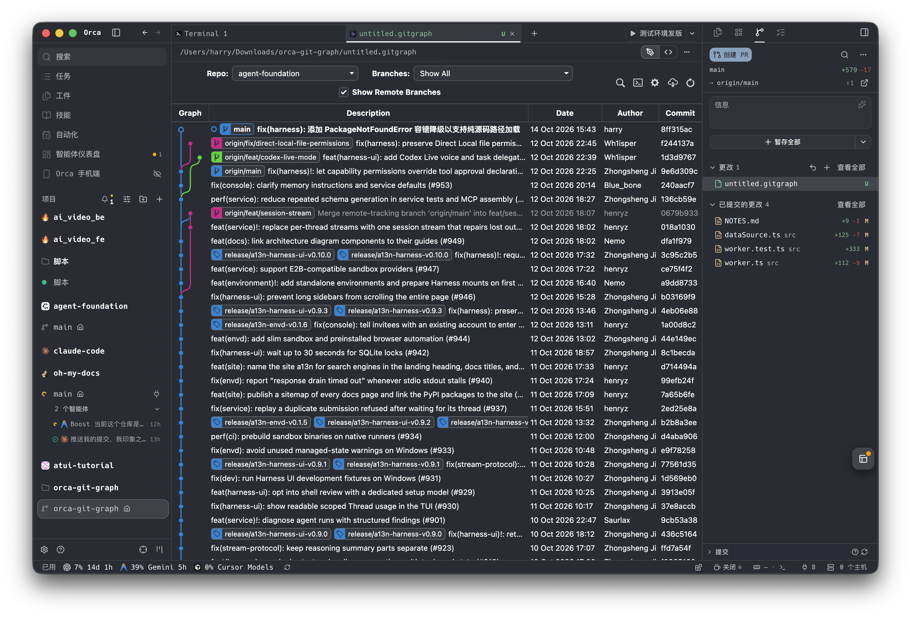

# Orca Git Graph




在 Orca 中间区域（编辑器标签页）运行的 Git 提交图插件：可视化分支/标签/提交历史，并直接执行常用 Git 操作。

> ⚠️ **版权声明（使用前必读）**
>
> - 本项目是 [mhutchie/vscode-git-graph](https://github.com/mhutchie/vscode-git-graph) v1.30.0（作者 Michael Hutchison / mhutchie）的**非官方 Orca 移植**，与原作者无任何关联，未获原作者背书。
> - `editor/out.min.js`、`editor/out.min.css` 为原扩展的编译产物，原样复用；`src/dataSource.ts` 及 worker 中的消息协议处理参照原版 `dataSource.js` / `gitGraphView.js` 移植。它们的版权归原作者所有。
> - 原许可（见 [editor/LICENSE-git-graph](editor/LICENSE-git-graph)）允许使用、复制、修改、合并，但**明确不允许发布、分发、再许可或销售衍生作品**（"Permission is NOT GRANTED to publish, distribute, sublicense, and/or sell derivative works of the Software"）。
> - 因此：本仓库**仅供个人本地使用**，保持私有；**不得公开仓库、上架 Orca 插件目录、分享安装包或用于商业用途**。如需公开分发，请先取得原作者书面许可。
> - 本项目不附带任何担保，执行 reset / drop / rebase / clean 等破坏性 Git 操作前请自行确认。

---

## 功能特性 (Features)

- **直观的可视化提交树**：清晰呈现分支分叉、合并节点、标签、提交说明、作者、日期和提交哈希。
- **全宽编辑器标签页体验**：以 Custom Editor 模式在全宽标签页中打开，彻底告别侧边栏拥挤。
- **全套 Git 分支管理**：
  - 检出分支（支持跟踪远程分支）、检出提交（Detached HEAD 并记忆选择）。
  - 创建新分支、强制删除分支（可选同步清理远程分支）、重命名分支。
  - 远程抓取 (`fetch` / `fetchIntoLocalBranch`)、拉取 (`pullBranch`，支持 `--squash`)、推送 (`pushBranch`，支持设置 upstream 与强制租约推送)。
- **标签与贮藏 (Tags & Stashes)**：
  - 支持轻量标签与带说明的附注标签，支持自动推送到远程；删除本地及远程标签。
  - 暂存区贮藏：`pushStash`（含未跟踪文件）、`applyStash`、`popStash`、`dropStash`，以及从贮藏项直接检出分支。
- **提交与历史操作**：
  - 樱桃摘取 (`cherry-pick`)、提交还原 (`revert`)、重置 (`reset` 支持 soft / mixed / hard)。
  - 快速丢弃提交 (`dropCommit`)、分支与提交合并 (`merge`)、历史衍合 (`rebase`)。
- **工作区清理**：
  - 清理未跟踪文件与文件夹 (`cleanUntrackedFiles`)。
  - 重置未提交变更 (`resetUncommitted`)。
- **多仓库支持**：
  - 自动识别 Orca 多 Worktree 架构，在顶部 Repo 下拉框中直接切换当前工作区内的有效 Git 仓库。
  - 监听 `workspace.changed` 动态刷新仓库列表。
- **原生主题集成**：
  - 完整适配 Orca 深色/浅色主题及 `--orca-*` CSS 变量体系。

---

## 架构原理 (Architecture)

```text
┌─────────────────────────────────────────────────────────────┐
│                 Orca Custom Editor Frame                    │
│   (editor/index.html + out.min.js + out.min.css)            │
│       - window.acquireVsCodeApi() shim                      │
│       - window.orca.document.session 管理生命周期            │
└──────────────────────────────┬──────────────────────────────┘
                               │
                orca.plugin.request('msg', payload)
                orca.plugin.on('msg', callback)
                               │
                               ▼
┌─────────────────────────────────────────────────────────────┐
│                 Orca Trusted Worker Process                 │
│                      (src/worker.ts)                        │
│       - orca.panels.handle('msg') 处理消息派发              │
│       - 状态记忆 (globalViewState, workspaceViewState)     │
│       - 工作区关联与仓库解析 (getActiveRepo / getReposState) │
└──────────────────────────────┬──────────────────────────────┘
                               │
                       TypeScript 函数调用
                               │
                               ▼
┌─────────────────────────────────────────────────────────────┐
│                   DataSource (src/dataSource.ts)            │
│       - child_process.execFile 安全调用系统 Git             │
│       - 参数完全数组化，严防命令行选项注入 (validateRefName)  │
│       - 输出日志与差异流解析                                │
└─────────────────────────────────────────────────────────────┘
```

---

## 安装 (Installation)

要求：Orca ≥ 1.4.248 桌面版、系统已安装 `git`、Orca 设置中已开启插件（Settings → Plugins → Turn on plugins）。

```sh
# 1. 获取代码（私有仓库，需已登录有权限的 GitHub 账号）
gh repo clone kongds1999/orca-git-graph ~/orca-plugins/orca-git-graph

# 2. 校验
orca plugin validate ~/orca-plugins/orca-git-graph --json

# 3. 加载（首次会以 exit 3 / approval_required 返回授权清单与 fingerprint）
orca plugin dev load ~/orca-plugins/orca-git-graph --json

# 4. 阅读授权清单确认无误后，用上一步返回的 fingerprint 批准
orca plugin dev load ~/orca-plugins/orca-git-graph --approve <fingerprint> --json
```

插件申请的权限：`trusted-worker`（以当前用户身份运行一个 Node 进程，用于调用系统 git）、`storage:own`、`workspace:read`、`workspace:write`（在编辑器中打开文件）、`notifications:show`。

更新：`git -C ~/orca-plugins/orca-git-graph pull` 后执行 `orca plugin dev reload ~/orca-plugins/orca-git-graph --json`（若权限变化会再次要求批准）。
卸载：`orca plugin dev unload ~/orca-plugins/orca-git-graph --json`。

### 交给 Agent 一键安装

把 [AGENT_INSTALL.md](AGENT_INSTALL.md) 的内容（或下面这句话）发给 Claude Code / Codex 等 agent 即可：

```text
先执行 `gh repo clone kongds1999/orca-git-graph ~/orca-plugins/orca-git-graph`（私有仓库，已登录的 gh 有权限），
然后阅读其中的 AGENT_INSTALL.md 并严格按步骤把 Orca Git Graph 插件安装到本机 Orca。
```

### 开发

```sh
orca plugin dev watch .     # 加载并热重载
orca plugin test .          # 单元测试（含临时仓库中的写操作测试）
orca plugin check . --json  # 静态检查
```

---

## 使用指南 (Usage)

1. **打开 Git Graph**：
   - 点击 Orca 编辑器顶部的 `+` 菜单，选择 **Git Graph**。
   - 或者使用命令面板创建并打开一个 `.gitgraph` 文件。
2. **多仓库切换**：
   - 点击顶部控件栏的 `Repo` 下拉列表，切换到当前工作区识别到的任意 Git 仓库。
3. **分支与提交筛选**：
   - 使用 `Branches` 下拉菜单筛选要显示的分支，勾选 `Show Remote Branches` 查看远端拓扑。
4. **提交详情与上下文操作**：
   - 单击任意提交行展开 Commit Details View (CDV)，查看提交元数据和改动文件列表。
   - 右键单击分支徽标、提交或标签，唤起功能齐备的上下文操作菜单（检出、重命名、合并、衍合、标签操作等）。

---

## 已知限制 (Known Limitations)

1. **差异对比 (Diff View)**：点击改动文件会在编辑器中打开该文件；差异对比请使用 Orca 自带的 diff。
2. **交互式衍合 (Interactive Rebase)**：因插件运行于非 TTY 交互沙箱，交互式 rebase 暂无法通过终端编辑器输入调整提交序列。
3. **远程头像 (Avatars)**：离线及无网络权限沙箱环境下，Gravatar 头像拉取保持静默关闭。

---

## 许可证 (License)

本仓库不另行授予任何开源许可。原作部分（编译产物及移植代码）受 [editor/LICENSE-git-graph](editor/LICENSE-git-graph) 约束；Orca 适配胶水代码（`editor/index.html` 中的 shim、`src/worker.ts` 中与 Orca 交互的部分、`icons/`）同样仅限个人使用。详见文首「版权声明」。
